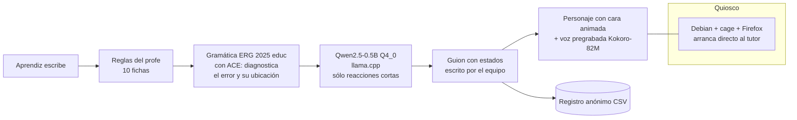

# Echo

**Un tutor de inglés que conversa sin internet, en computadores escolares viejos.**

> *Hecho para reducir la brecha educativa.*

Creado por Christiam Puentes, instructor de inglés del SENA en Málaga, Santander (Colombia).

**Estado:** prototipo medido en laboratorio. Aún no lo han usado estudiantes reales (el piloto está preregistrado para el 9–18 de noviembre de 2026). Licencia: MIT (ver `LICENSE`).

---

## Lo esencial en 2 minutos

| Qué | Cifra | Dónde se mide |
|---|---|---|
| Frases con error detectadas: reglas + gramática + modelo | **59/90** (modelo solo: 53/90; McNemar p = 0,031) | `docs/results/RESULTADO_F1c.md` |
| Falsas alarmas | **1/30** | `docs/results/RESULTADO_F1c.md` |
| Corrección exacta | de **34 a 46** de 114 | `docs/results/RESULTADO_F1c.md` |
| Ejemplos en el prompt del 0,5B | **40/60 = 40/60** (recuperados = al azar; resultado negativo) | `docs/results/RESULTADO_F1.md` |
| Hardware | Chromebook Dell 11 de 2014, Celeron N2840 **sin AVX**, 4 GB | `docs/results/RESULTADO_F2.md` |
| Tiempo en modo corrector | **~6 s** por consulta | `docs/results/RESULTADO_F2.md` |
| Tiempo en conversación | **2–8 s** por turno | `docs/results/RESULTADO_F2.md` |
| Memoria RAM | **0,75 GB** | `docs/results/RESULTADO_F2.md` |
| Parte simbólica (reglas + gramática) | **0,43 s**, idéntica a la del PC (**68/68**) | `docs/results/RESULTADO_F2.md` |
| Optimización H06 al escribir | **×1,56–1,67** | `docs/results/RESULTADO_H06.md` |
| Bucle de mejora (6-nov) | 6308 pares; validación **616/955** (65 %) con **39/1275** falsas (3 %); aún sin banco ciego | `echo/training/` |

Todo con preregistro y bancos ciegos construidos por un agente aparte.

---

## Qué es

El aprendiz elige una **situación real**:

- la tienda de la vereda
- una entrevista de trabajo
- presentar su proyecto
- la finca
- soporte técnico
- dar indicaciones a un turista en Málaga
- presentar su animación
- el mercado de Málaga
- la Feria de San Jerónimo
- el páramo del Almorzadero
- la tienda de lana en Concepción

Un **personaje con cara animada y voz natural** conversa con él:

- Sólo avanza si el aprendiz responde lo que se le preguntó.
- Le ayuda **por escalones**.
- **Corrige poco**: máximo 1 vez cada 3 turnos, con la pista del profe en español. El resto queda en un resumen «dilo otra vez».
- Celebra el progreso y cuenta las palabras dichas.
- Responde «¿qué eres?» con respuestas verificadas.
- Deja un **registro anónimo en CSV**.

## Por qué

- Hay zonas rurales **sin internet** y **sin profesor de inglés**.
- Los equipos escolares son **viejos**.
- La **práctica oral** es escasa.

## Cómo funciona (neurosimbólico)



1. **Reglas del profe** (10 fichas): detectores deterministas de los errores típicos de hispanohablantes.
2. **Gramática ERG 2025 «educ» con ACE**: diagnostica el error y dónde está.
3. **Modelo pequeño** Qwen2.5-0.5B Q4_0 con llama.cpp, sólo para reacciones cortas.
4. **Guion con estados** escrito por el equipo: el modelo no conduce la conversación.
5. **Voz pregrabada** con Kokoro-82M (cero cómputo de voz en el equipo del aula).
6. **Quiosco**: Debian + cage + Firefox; el equipo arranca directo al tutor.

## Evidencia

Todo con preregistro y bancos ciegos hechos por un agente aparte. Los resultados negativos se reportan.

- **Los ejemplos en el prompt NO ayudan al 0,5B.** 40/60 con ejemplos recuperados, igual que 40/60 al azar (`RESULTADO_F1.md`).
- **Reglas + gramática + modelo** detectan **59/90** frases con error frente a **53/90** del modelo solo (McNemar p = 0,031), con **1/30** falsas alarmas. La corrección exacta sube de **34 a 46 de 114** (`RESULTADO_F1c.md`).
- **Todo corre en un Chromebook Dell 11 de 2014** (Celeron N2840 sin AVX, 4 GB): ~6 s por consulta en modo corrector, 2–8 s por turno en conversación, 0,75 GB de RAM. La parte simbólica tarda 0,43 s y es idéntica a la del PC (68/68) (`RESULTADO_F2.md`).
- **Optimización H06:** ×1,56–1,67 al escribir (`RESULTADO_H06.md`).

## Estado honesto

- **Aún no lo han usado estudiantes reales.**
- El **piloto preregistrado** es del **9 al 18 de noviembre de 2026** con aprendices del SENA (`docs/pilot/`).
- **No se afirma que mejore el aprendizaje**: eso no se ha medido.
- La **entrada por voz** está en camino.

## Instalación (resumen)

Los archivos grandes **no están en el repositorio**: modelo GGUF, gramática ERG (`.dat`) y audios.

1. **Equipo:** Debian (o similar) con Python 3. Compilar llama.cpp (en CPUs sin AVX, compilar sin esas instrucciones).
2. **Modelo:** descargar Qwen2.5-0.5B-Instruct (Apache-2.0), cuantizarlo a Q4_0 y servirlo con `llama-server` en el puerto 8097 (ver `echo/app/quiosco/backend.sh`).
3. **Gramática:** obtener ACE y la ERG 2025 (MIT), compilar la variante «educ» y apuntar `ERG_DIR` a esa carpeta.
4. **Audio:** instalar Kokoro-82M (`echo/app/voz/instala_kokoro.sh`), generar la lista con `voz/frases_fijas.py` y los `.wav` con `voz/genera_audio.py`.
5. **Correr:** `cd echo/app && python3 -B demo.py --tutor ../vendor --puerto 8080` (detalle en `echo/app/README.md`).
6. **Modo quiosco (root):** `echo/app/quiosco/instala_quiosco_root.sh`. Se revierte con `revierte_quiosco_root.sh`.

**Rutas absolutas a ajustar.** Los scripts conservan rutas del Chromebook original (`/home/christiam/f2/...`, `/home/christiam/llama/...`) y el valor por defecto de `ERG_DIR` en `echo/core/erg/erg.py`. También hay marcadores `IP_DEL_CHROMEBOOK` e `IP_DEL_SERVIDOR` en scripts de despliegue. Los scripts que llaman a la API de Anthropic (`echo/training/bucle.py`, `echo/app/voz/genera_modulos_api.py`, `echo/app/voz/revisa_e_instala.py`) leen la clave de la variable `ANTHROPIC_API_KEY`; **no hay claves en el repositorio**.

## Estructura

```
echo/app/       servidor y página del tutor, escenarios, voz, quiosco
echo/core/      fichas, detectores, ejemplos curados, ERG (reparar)
echo/training/  bucle de mejora continua
echo/vendor/    paquete tutor (cliente de llama.cpp)
docs/           resultados, piloto, investigación
```

## Mejora continua

Un bucle donde **Claude genera errores sintéticos filtrados por la gramática** y se reentrena un etiquetador. El director es **Haiku con memoria por consecuencia** (*alefast*, repositorio aparte). Cifras del bucle al 6-nov: **6308 pares**, validación **616/955 detectadas (65 %)** con **39/1275 falsas (3 %)**; **aún no medido en banco ciego**. Ver `echo/training/PREREGISTRO_bucle.md`.

## Para aliados y financiadores

**Qué buscamos:** piloto con más escuelas, hardware y financiación.

**Por qué es distinto:**

- **Hardware mucho más débil** de lo habitual (un Celeron de 2014 sin AVX, 4 GB).
- **Corrección verificable**: las reglas y la gramática explican el error y dónde está.
- **Medición ciega** y preregistrada, con resultados negativos incluidos.
- **Contexto local de García Rovira** (Málaga, Concepción, el páramo del Almorzadero; fuentes en `echo/app/GARCIA_ROVIRA_fuentes.md`).

## Autor y contacto

**Christiam Puentes**, instructor de inglés del SENA, Málaga, Santander, Colombia. Contacto: ddiddimmo@gmail.com.

**Cómo citar:**

> Puentes, C. (2026). *Echo: tutor de inglés offline para computadores escolares viejos*. Repositorio de software, Málaga, Santander, Colombia.

## Licencia

Licencia: MIT (ver `LICENSE`).

Componentes de terceros con su licencia: ERG (MIT), ACE (MIT), llama.cpp (MIT), Qwen2.5 (Apache-2.0), Kokoro-82M (Apache-2.0) y cage (MIT).

---

## English summary

**Echo** is an English tutor that holds spoken-style conversations **fully offline** on old school computers, built for rural learners in García Rovira, Santander (Colombia), where there is no internet and no English teacher. Created by Christiam Puentes, SENA English instructor. *Made to reduce the educational gap.*

The learner picks a real-life situation (village shop, job interview, farm, tech support, giving directions to a tourist, local market, fair, páramo, wool shop). An animated character with a natural pre-recorded voice (Kokoro-82M) talks with them, advances only when the answer fits the question, scaffolds help, and corrects sparingly (at most once every 3 turns, with a Spanish hint from the teacher). It celebrates progress, counts words spoken and logs anonymous usage to CSV.

**Neurosymbolic design:** teacher rules (10 cards) -> ERG 2025 "educ" grammar with ACE (diagnoses the error and its location) -> small Qwen2.5-0.5B Q4_0 model on llama.cpp, used only for short reactions -> a hand-written state script. Kiosk: Debian + cage + Firefox.

**Evidence (preregistered, blind banks built by a separate agent):**

| Finding | Result |
|---|---|
| In-prompt examples for the 0.5B model | 40/60 retrieved = 40/60 random (negative result) |
| Error detection, rules + grammar + model vs. model alone | 59/90 vs. 53/90 (McNemar p = 0.031), 1/30 false alarms |
| Exact correction | 34 -> 46 of 114 |
| Hardware | 2014 Dell Chromebook 11, Celeron N2840 (no AVX), 4 GB: ~6 s per query (corrector mode), 2-8 s per conversational turn, 0.75 GB RAM |
| Symbolic part | 0.43 s, identical to the PC (68/68) |
| H06 optimization | x1.56-1.67 writing speed |
| Continuous-improvement loop (6 Nov) | 6308 pairs; validation 616/955 detected (65 %), 39/1275 false (3 %); not yet measured on a blind bank |

**Honest status:** no real students have used it yet. A preregistered pilot runs 9-18 Nov 2026 with SENA learners. We do **not** claim it improves learning (not measured). Voice input is in progress.

**Install:** large files (GGUF model, ERG `.dat`, audio) are not in the repo; see "Instalación" above. Absolute paths from the original Chromebook (`/home/christiam/...`) remain in scripts and must be adjusted.

**Looking for:** pilots in more schools, hardware and funding. **What is different:** much weaker hardware, verifiable correction, blind measurement, and local García Rovira context.

**License:** MIT (see `LICENSE`). Third-party: ERG (MIT), ACE (MIT), llama.cpp (MIT), Qwen2.5 (Apache-2.0), Kokoro-82M (Apache-2.0), cage (MIT).

**Contact:** Christiam Puentes, ddiddimmo@gmail.com.
